# ReturnLoop — Entity Relationship Diagram

```mermaid
erDiagram
    ORGANIZATIONS ||--o{ USERS : "employs"
    ORGANIZATIONS ||--o{ PRODUCTS : "catalogues"
    ORGANIZATIONS ||--o{ LOCATIONS : "operates"
    ORGANIZATIONS ||--o{ VEHICLES : "owns"
    ORGANIZATIONS ||--o{ DRIVERS : "employs"
    ORGANIZATIONS ||--o{ RETURN_REQUESTS : "tracks"
    ORGANIZATIONS ||--o{ PARTNERS : "contracts"
    ORGANIZATIONS ||--o{ NOTIFICATIONS : "raises"
    ORGANIZATIONS ||--o{ AUDIT_EVENTS : "records"
    ORGANIZATIONS ||--o{ IDEMPOTENCY_RECORDS : "guards"

    USERS ||--o{ NOTIFICATIONS : "receives"

    PRODUCTS ||--o{ RETURN_ITEMS : "referenced by"
    PRODUCTS ||--o{ INVENTORY_ITEMS : "referenced by"

    RETURN_REQUESTS ||--o{ RETURN_ITEMS : "contains"
    RETURN_REQUESTS ||--o{ RETURN_EVENTS : "records"
    RETURN_REQUESTS ||--o{ INSPECTIONS : "inspected by"
    RETURN_REQUESTS ||--o{ RECOVERY_RECOMMENDATIONS : "evaluated by"
    RETURN_REQUESTS ||--o{ RECOVERY_JOBS : "worked by"
    RETURN_REQUESTS ||--o{ PICKUP_JOBS : "collected by"

    RETURN_ITEMS ||--o{ INSPECTIONS : "inspected as"
    RETURN_ITEMS ||--o{ RECOVERY_RECOMMENDATIONS : "recommended for"
    RETURN_ITEMS ||--o{ RECOVERY_JOBS : "processed by"

    INSPECTIONS ||--o{ INSPECTION_ATTACHMENTS : "documents"

    INVENTORY_ITEMS ||--o{ INVENTORY_MOVEMENTS : "moved by"
    INVENTORY_ITEMS ||--o{ RECOVERY_JOBS : "allocated to"

    PARTNERS ||--o{ RECOVERY_JOBS : "performs"
    RECOVERY_JOBS ||--o{ RECOVERY_JOB_EVENTS : "records"

    VEHICLES ||--o{ PICKUP_JOBS : "collects"
    DRIVERS ||--o{ PICKUP_JOBS : "drives"
    VEHICLES ||--o{ ROUTES : "runs"
    DRIVERS ||--o{ ROUTES : "drives"

    ROUTES ||--o{ ROUTE_STOPS : "sequences"
    PICKUP_JOBS ||--o{ ROUTE_STOPS : "stops at"

    ORGANIZATIONS {
        uuid id PK
        varchar name
        varchar slug UK
        varchar default_currency
        int holding_threshold_days
    }

    USERS {
        uuid id PK
        uuid organization_id FK
        varchar email
        varchar password_hash
        varchar role
        boolean active
    }

    PRODUCTS {
        uuid id PK
        uuid organization_id FK
        varchar sku
        varchar name
        varchar category
        numeric original_price
        numeric resale_value
        numeric weight_kg
    }

    LOCATIONS {
        uuid id PK
        uuid organization_id FK
        varchar name
        varchar location_type
        numeric latitude
        numeric longitude
    }

    VEHICLES {
        uuid id PK
        uuid organization_id FK
        varchar name
        int capacity_units
        numeric capacity_kg
    }

    DRIVERS {
        uuid id PK
        uuid organization_id FK
        varchar name
        varchar license_number
    }

    RETURN_REQUESTS {
        uuid id PK
        uuid organization_id FK
        varchar return_number
        varchar status
        varchar reason
        numeric estimated_value
        numeric realized_value
        int item_count
    }

    RETURN_ITEMS {
        uuid id PK
        uuid return_id FK
        uuid product_id FK
        varchar sku
        int quantity
        varchar condition
        numeric estimated_value
    }

    RETURN_EVENTS {
        uuid id PK
        uuid return_id FK
        varchar event_type
        varchar from_status
        varchar to_status
        varchar description
    }

    INVENTORY_ITEMS {
        uuid id PK
        uuid organization_id FK
        uuid return_id FK
        varchar sku
        int quantity
        int reserved_quantity
        varchar status
        varchar condition
        numeric estimated_value
    }

    INVENTORY_MOVEMENTS {
        uuid id PK
        uuid inventory_item_id FK
        varchar movement_type
        int quantity
        varchar from_status
        varchar to_status
    }

    INSPECTIONS {
        uuid id PK
        uuid return_id FK
        uuid return_item_id FK
        varchar status
        boolean functional
        boolean accessories_complete
        boolean flagged_unsafe
        numeric estimated_repair_cost
    }

    INSPECTION_ATTACHMENTS {
        uuid id PK
        uuid inspection_id FK
        varchar file_name
        varchar content_type
        bigint size_bytes
    }

    RECOVERY_RECOMMENDATIONS {
        uuid id PK
        uuid return_id FK
        uuid return_item_id FK
        varchar recommended_path
        numeric recommended_net_value
        text options_json
        varchar strategy
        boolean approved
        boolean rejected
    }

    PARTNERS {
        uuid id PK
        uuid organization_id FK
        varchar name
        varchar partner_type
        varchar serviceable_regions
        varchar supported_categories
        int processing_capacity_per_day
        boolean currently_available
        int completed_jobs
        numeric average_processing_days
        numeric on_time_rate
    }

    RECOVERY_JOBS {
        uuid id PK
        uuid organization_id FK
        uuid return_id FK
        uuid inventory_item_id FK
        uuid partner_id FK
        varchar job_number
        varchar recovery_path
        varchar status
        numeric expected_recovery_value
        numeric cost_estimate
        numeric realized_value
        date service_deadline
    }

    RECOVERY_JOB_EVENTS {
        uuid id PK
        uuid job_id FK
        varchar event_type
        varchar from_status
        varchar to_status
    }

    PICKUP_JOBS {
        uuid id PK
        uuid organization_id FK
        uuid return_id FK
        uuid vehicle_id FK
        uuid driver_id FK
        uuid route_id FK
        varchar pickup_number
        varchar status
        date scheduled_date
        numeric estimated_distance_km
    }

    ROUTES {
        uuid id PK
        uuid organization_id FK
        uuid vehicle_id FK
        uuid driver_id FK
        varchar route_number
        varchar status
        date route_date
        int stop_count
        numeric estimated_distance_km
        varchar algorithm
    }

    ROUTE_STOPS {
        uuid id PK
        uuid route_id FK
        uuid pickup_job_id FK
        int sequence
        numeric latitude
        numeric longitude
        boolean completed
    }

    NOTIFICATIONS {
        uuid id PK
        uuid organization_id FK
        uuid user_id FK
        varchar title
        varchar category
        varchar severity
        boolean read
    }

    AUDIT_EVENTS {
        uuid id PK
        uuid organization_id FK
        varchar actor
        varchar action
        varchar entity_type
        uuid entity_id
    }

    IDEMPOTENCY_RECORDS {
        uuid id PK
        uuid organization_id FK
        varchar idempotency_key
        varchar operation
        varchar request_fingerprint
        boolean completed
    }
```

## Key relationships

| From | To | Cardinality | Notes |
| --- | --- | --- | --- |
| `organizations` | everything | 1 : n | The tenant root. Every table cascades on delete. |
| `return_requests` | `return_items` | 1 : n | An aggregate root and its lines. |
| `return_items` | `inspections` | 1 : n | A line may be inspected more than once; the latest wins. |
| `return_items` | `recovery_recommendations` | 1 : n | Each calculation is stored with its full option set. |
| `inventory_items` | `recovery_jobs` | 1 : n | A unique index on `(organization_id, inventory_item_id)` for active jobs is enforced in the service layer, not by the schema, because only non-terminal jobs block a second assignment. |
| `routes` | `route_stops` | 1 : n | Stops are ordered by `sequence`; each references the pickup it serves. |
| `partners` | `recovery_jobs` | 1 : n | Partner performance metrics are recomputed from completed jobs, never entered by hand. |
| `users` | `notifications` | 1 : n | Notifications fan out to every active user in the organisation. |

## Constraints

* `uq_users_org_email` — an email is unique within an organisation.
* `uq_products_org_sku` — a SKU is unique within an organisation.
* `uq_returns_org_number`, `uq_jobs_org_number`, `uq_pickups_org_number`, `uq_routes_org_number` —
  human-readable identifiers are unique within an organisation.
* `uq_idempotency_org_key` — an idempotency key cannot be reused.
* `ck_inventory_non_negative` — `quantity >= 0`, `reserved_quantity >= 0` and
  `reserved_quantity <= quantity`.
* Foreign keys on every relationship, all with `ON DELETE CASCADE` from the tenant.

## Indexes

Every table is indexed on `organization_id`, because every query in the application is tenant
scoped. Composite indexes cover the common access patterns: `(organization_id, status)`,
`(organization_id, created_at)`, `(organization_id, sku)` and `(organization_id, category)`.
